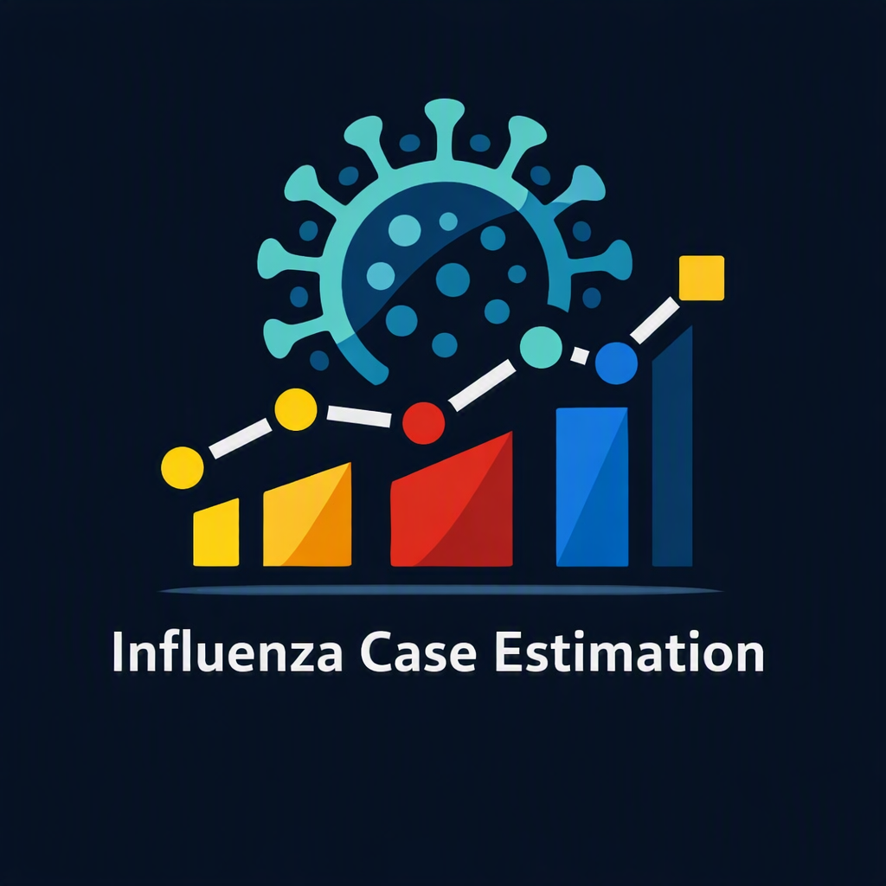

[](https://doi.org/10.5281/zenodo.23964593)
[](https://github.com/mrvnschulte/influenza_case_estimation/actions/workflows/tests.yml)
[](https://codecov.io/gh/mrvnschulte/influenza_case_estimation)
[](https://mrvnschulte.github.io/influenza_case_estimation/)

<p align="center">
  
</p>

# Influenza Case Estimation

A Python package for estimating weekly symptomatic influenza cases and distributing them across influenza strains using CDC surveillance data.

## Overview

This package combines national influenza surveillance data with seasonal estimates of total symptomatic illnesses. It provides:

- Loading of national weighted influenza-like illness (ILI) rates
- Loading of national weekly influenza test positivity rates
- Calculation of weekly influenza activity from ILI rates and test positivity
- Proportional allocation of seasonal illness estimates across weeks
- Exact integer case allocation using the largest remainder method
- Calculation of weekly fractions for A(H1N1), A(H3), B/Victoria, and B/Yamagata
- Distribution of weekly case estimates across influenza strains
- Scripts for exporting weekly case estimates and plotting influenza activity

## Installation

For development:

```bash
git clone https://github.com/mrvnschulte/influenza_case_estimation.git
cd influenza_case_estimation
pip install -e ".[dev]"
```

## Requirements

- Python >= 3.10
- NumPy >= 1.20.0
- pandas >= 1.3.0

The plotting scripts also require Matplotlib.

## Documentation

The API documentation is available at:

[https://mrvnschulte.github.io/influenza_case_estimation/](https://mrvnschulte.github.io/influenza_case_estimation/)


## Method Description

Weekly influenza activity is estimated as the product of the weighted ILI rate and influenza test positivity:

$$A_w = I_w \cdot P_w$$

where \(I_w\) is the weighted ILI rate and \(P_w\) is the influenza test positivity for week \(w\).

A season’s total symptomatic illness estimate is distributed among the included weeks in proportion to their activity:

$$C_w = C_{\text{total}} \cdot \frac{A_w}{\sum_j A_j}$$

Weekly case estimates are converted to integers using the largest remainder method, ensuring that their sum equals the seasonal total.

The weekly estimates are then distributed across four strains using their surveillance-based fractions:

$$C_{w,s} = C_w \cdot F_{w,s}$$

where \(F_{w,s}\) is the fraction of strain \(s\) in week \(w\). The four model strains are A(H1N1), A(H3), B/Victoria, and B/Yamagata.

## Project Structure

```text
influenza_case_estimation/
├── __init__.py                         # Public API
├── core.py                             # Activity and case-estimation functions
├── load_data.py                        # CDC surveillance and burden data loaders
├── export_weekly_cases_per_variant.py  # Estimates and exports cases by strain
├── plot_cases_per_variant.py           # Plots weekly cases by strain
└── plot_weekly_cases.py                # Plots total weekly cases

## Running the Scripts

The scripts expect the CDC source CSV files in a `data/` directory and write outputs to a `plots/` directory or to the configured CSV path. Run them from the project directory:

```bash
python export_weekly_cases_per_variant.py
python plot_weekly_cases.py
python plot_cases_per_variant.py
```

The seasons and file paths are configured near the end of each script.

## API Reference

### Core (`core.py`)

| Function | Description |
|---|---|
| `weekly_influenza_activity` | Calculates weekly activity as the product of ILI rate and test positivity |
| `weekly_influenza_cases` | Allocates a seasonal total across weeks using activity weights and largest-remainder integer rounding |
| `weekly_cases_per_strain` | Distributes weekly case estimates across strains using weekly fractions |

### Data Loading (`load_data.py`)

| Function | Description |
|---|---|
| `load_weighted_ili_rate` | Loads national weekly weighted ILI rates and converts percentages to proportions |
| `load_test_positivity` | Loads national weekly influenza test positivity and converts percentages to proportions |
| `load_symptomatic_illnesses` | Loads estimated symptomatic illnesses by influenza season |
| `load_strain_fractions` | Loads and calculates weekly fractions for the four model strains |

## Data Sources

The loaders expect CDC CSV files for ILINet, clinical laboratory test positivity, public health laboratory strain counts, and seasonal influenza burden estimates. Pass the relevant file paths to the loading functions.

## Citation

If you use this software in your research, please cite:

[Citation will be added upon publication]

## License

This project is licensed under the [BSD 3-Clause License](LICENSE).

## Author

Marvin Schulte – [marvin.schulte@itwm.fraunhofer.de](mailto:marvin.schulte@itwm.fraunhofer.de)

Department Flow Processes, Division Processes and Materials, Fraunhofer Institute for Industrial Mathematics ITWM  
Department of Mathematics, RPTU University of Kaiserslautern-Landau
